<div align="center">



<br/>

[](https://peenakawedamulla-portfolio.vercel.app/)
[](https://www.linkedin.com/in/peenaka-wedamulla-60a52122a)
[](mailto:peenakawedamulla123@gmail.com)
[](https://peenakawedamulla-portfolio.vercel.app/peenaka-wedamulla-resume.pdf)

</div>

<br/>

I build the safety net under FinTech platforms: test architectures, CI/CD pipelines and performance suites for systems where **high concurrency and zero downtime** aren't optional. I also design and ship full-stack systems, because the engineer who tests software should be able to build it too.

> `// breaking builds in CI before users see them ⚡`

<br/>

### `▶ pipeline run #2026`

```yaml
✓ checkout     Colombo, Sri Lanka · open to UK / EU / Remote
✓ install      Selenium · Playwright · Appium · REST Assured · JMeter
✓ lint         3+ years commercial QA · LOLC Technologies (iPay · FusionX)
✓ build        Jenkins · Docker · Kubernetes · GitHub Actions
✓ test         70% regression time cut on major iPay releases
✓ observe      JMeter load tests → Grafana dashboards
✓ lead         Leo Club district leadership · community mentor
→ deploy       currently shipping @ LOLC Technologies · NexorByte
```

<br/>

### `/system`

<table>
<tr>
<td width="25%" valign="top"><b>QA &amp; Automation</b><br/><sub>suites that catch what humans forget</sub></td>
<td>


</td>
</tr>
<tr>
<td valign="top"><b>DevOps</b><br/><sub>every merge is a release candidate</sub></td>
<td>


</td>
</tr>
<tr>
<td valign="top"><b>Full-Stack</b><br/><sub>the systems around the tests</sub></td>
<td>


</td>
</tr>
<tr>
<td valign="top"><b>AI / Cloud</b><br/><sub>modern platforms, applied to testing</sub></td>
<td>


</td>
</tr>
</table>

<br/>

### `/selected-work`

| Project | What it proves |
| :-- | :-- |
| **[Espresso Android Automation Framework](https://github.com/Peenaka/espresso-browserstack-android-ui-automation-enterprise-framework)** | Pluggable, enterprise-grade Android UI framework: BrowserStack, thread-safe parallel runs, Allure + Extent reporting |
| **[iPay: Mobile & API Automation](https://peenakawedamulla-portfolio.vercel.app/projects/ipay-mobile-api)** | Appium + REST Assured regression on Android & iOS, wired into Jenkins |
| **[iPay Web Portals](https://peenakawedamulla-portfolio.vercel.app/projects/ipay-web-portals)** | Parallel cross-browser Selenium / Playwright across Chromium, Firefox and WebKit |
| **[FusionX: Automation, Performance & K8s](https://peenakawedamulla-portfolio.vercel.app/projects/fusionx-automation-performance)** | Selenium + JMeter + Grafana on containerised Kubernetes test environments |
| **[Real-Time Event Ticketing](https://peenakawedamulla-portfolio.vercel.app/projects/event-ticketing-realtime)** | Spring Boot + Angular + WebSockets: live, concurrent booking |

<br/>

### `/field-notes`

- [AI in Testing: What Actually Works (and What Doesn't)](https://peenakawedamulla-portfolio.vercel.app/blog/ai-in-testing-what-actually-works)
- [Kubernetes-Backed Test Environments: Notes From FinTech](https://peenakawedamulla-portfolio.vercel.app/blog/kubernetes-test-environments)
- [Playwright vs Selenium in FinTech: When to Pick Which](https://peenakawedamulla-portfolio.vercel.app/blog/playwright-vs-selenium-fintech)

<br/>

### `/beyond-the-terminal`

🦁 **Leo Organization**, from Club Secretary at Leo Club of Southern Metro to **Multiple District Assistant Treasurer** (Leo MD 306, Sri Lanka & Maldives) and **District Secretary** (306 D8).

🎥 **Richmond Live**: sports videography and live production since 2019.

<br/>

<div align="center">


<br/><br/>

**Available · Open to UK / EU / Remote SDET & DevOps roles**
<br/>
<sub>Let's ship the pipeline. → <a href="mailto:peenakawedamulla123@gmail.com">peenakawedamulla123@gmail.com</a></sub>

</div>
